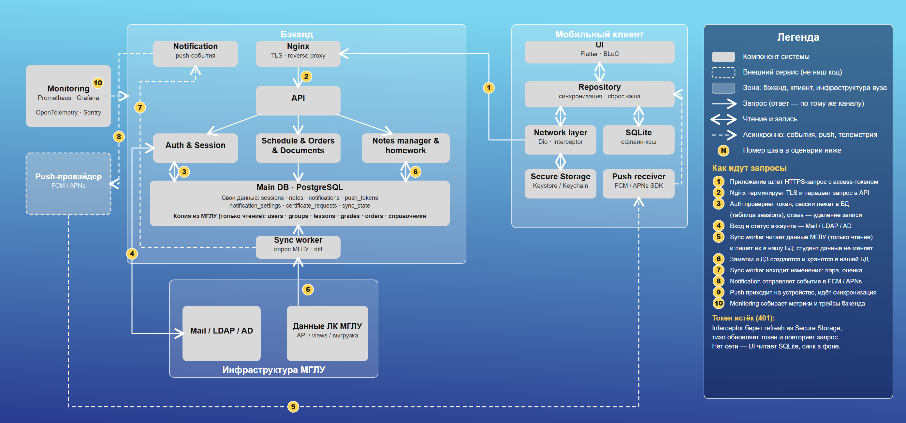

# Архитектура MSLU App

Документ описывает архитектуру клиент-серверного приложения MSLU App: компоненты, потоки данных, сессии и отзыв доступа, синхронизацию с МГЛУ, push-уведомления, безопасность и мониторинг. Возможности для пользователя — в [README.md](../README.md). Какие данные храним и запрашиваем у вуза — в [data-and-integration.md](data-and-integration.md).

## Стек

- **Frontend:** Flutter, BLoC, Dio, SQLite (`drift`/`sqflite`), Secure Storage (Keystore/Keychain)
- **Backend:** Python/Node.js, PostgreSQL, JWT
- **Infra:** Docker, Docker Compose, Nginx
- **Мониторинг:** Prometheus, Grafana, OpenTelemetry, Sentry
- **Push:** FCM / APNs

## Схема

Правила чтения схемы:

- Стрелка идёт от инициатора, ответ возвращается по тому же каналу.
- Двусторонняя стрелка только там, где есть и чтение, и запись: сессии, заметки, LDAP.
- Пунктир — асинхронно: события, push, телеметрия.
- Пунктирная рамка — внешний сервис, не наш код.

## Принципы

1. **Данные МГЛУ только на чтение.** Расписание, приказы и оценки студент не меняет. Единственная запись в МГЛУ — заявка на справку об обучении.
2. **API читает только из нашей БД.** МГЛУ напрямую в пользовательском запросе не опрашивается. Фоновый Sync worker забирает данные и обновляет кэш в PostgreSQL. Так приложение работает, когда ЛК медленный или недоступен, и мы можем сравнить новое состояние с прошлым (замена пары, новая оценка).
3. **Заметки и ДЗ наши.** Студент создаёт их себе, преподаватель — группе. В МГЛУ они не уходят.
4. **Redis не используется.** Сессии лежат в таблице `sessions` в PostgreSQL. Вернуть Redis стоит, только если вырастет нагрузка: несколько экземпляров API, лимиты запросов, очередь push. Хранилище сессий спрятано за интерфейсом, чтобы замена не затронула остальной код.
5. **Offline-first.** Клиент показывает расписание, оценки и заметки из локальной SQLite, пока нет сети.

## Компоненты

### Мобильный клиент (Flutter)

| Компонент | Назначение |
|---|---|
| UI (BLoC) | Экраны, состояние |
| Repository | Единая точка данных для UI: синхронизация, сброс кэша |
| Network layer (Dio + Interceptor) | HTTPS-запросы, перехват 401 и тихое обновление токена |
| SQLite | Офлайн-кэш расписания, оценок, заметок |
| Secure Storage | Refresh-токен и ключи в Keystore/Keychain |
| Push receiver | SDK FCM/APNs, по push запускает синхронизацию |

### Бэкенд

| Компонент | Назначение |
|---|---|
| Nginx | Терминирует TLS, reverse proxy, единая точка входа |
| API | Маршрутизация запросов к модулям |
| Auth & Session | Вход, выдача и обновление токенов, сессии, проверка статуса аккаунта |
| Schedule & Orders & Documents | Отдача расписания, оценок, приказов из БД; заявки на справки |
| Notes manager & homework | Заметки и ДЗ |
| Sync worker | Фоновое чтение данных МГЛУ, запись в БД, поиск изменений (diff) |
| Notification service | Получает события от Sync worker, отправляет в FCM/APNs |
| PostgreSQL | Свои данные и кэш данных МГЛУ |

### Внешние системы

| Система | Роль |
|---|---|
| Mail / LDAP / AD МГЛУ | Вход, статус аккаунта (для отзыва доступа). Расписание не содержит |
| Данные ЛК МГЛУ | Источник расписания, оценок, приказов. Способ получения (API / views / выгрузка / парсер) пока не определён |
| Push-провайдер (FCM / APNs) | Доставка push на устройство |
| Monitoring | Метрики и трейсы бэкенда |

## Шаги запроса (нумерация как на схеме)

| № | Шаг | Описание |
|---|---|---|
| 1 | Клиент → Nginx | HTTPS-запрос с access-токеном |
| 2 | Nginx → API | TLS терминируется, запрос передаётся в API |
| 3 | Auth ↔ БД | Проверка токена и сессии в таблице `sessions`, отзыв — удаление записи |
| 4 | Auth ↔ LDAP | Вход и статус аккаунта |
| 5 | МГЛУ → Sync worker → БД | Чтение данных МГЛУ и запись в БД. Студент данные не меняет |
| 6 | Notes ↔ БД | Заметки и ДЗ создаются и хранятся в нашей БД |
| 7 | Sync worker → Notification | Событие об изменении: замена пары, новая оценка |
| 8 | Notification → Push-провайдер | Отправка в FCM/APNs |
| 9 | Push-провайдер → устройство | Push приходит на устройство, клиент запускает синхронизацию |
| 10 | Monitoring | Сбор метрик и трейсов бэкенда |

Запрос расписания: клиент (1) → Nginx (2) → API → Schedule → чтение из PostgreSQL. Обращения к МГЛУ в этой цепочке нет.

## 1. Авторизация и жизненный цикл сессии

### 1.1. Токены

- **Access token:** JWT со сроком жизни 15 минут. Подпись асимметричная (RS256 или EdDSA): сервер подписывает приватным ключом, проверяют публичным. Это позволяет клиенту проверять подписанные метки офлайн (см. 1.4).
- **Refresh token:** срок жизни до 30 дней. В БД хранится только его хеш.
- **Ротация refresh:** при каждом обновлении выдаётся новая пара токенов, старый refresh перестаёт действовать. Если старый refresh предъявлен повторно, считаем его украденным и отзываем всю сессию.
- Access-токен нельзя отозвать сам по себе, он действует до истечения. Поэтому его срок короткий, а отзыв доступа делается через сессию (см. 1.3).

### 1.2. Тихое обновление (Silent Refresh)

1. Запрос уходит с истекшим access-токеном, бэкенд отвечает `401 Unauthorized`.
2. Interceptor в Network layer берёт refresh-токен из Secure Storage (Keystore/Keychain) и вызывает `/api/v1/auth/refresh`.
3. Бэкенд проверяет хеш в `sessions`, выдаёт новую пару и обновляет запись.
4. Исходный запрос повторяется без экрана входа.

Если refresh истёк (30 дней без обращений) или сессия отозвана, клиент удаляет токены и открывает экран авторизации.

В Secure Storage хранится именно refresh-токен, а не пароль пользователя.

### 1.3. Сессии на сервере

Сессии лежат в таблице `sessions` в PostgreSQL:

| Поле | Назначение |
|---|---|
| user_id, device_id | Чей токен и на каком устройстве |
| refresh_token_hash | Хеш refresh-токена |
| created_at, expires_at | Срок жизни |
| revoked_at | Отметка об отзыве |
| last_seen | Последняя активность |

Это даёт:

- отзыв сессии одного устройства: проставить `revoked_at` или удалить запись;
- завершение всех сессий пользователя (смена пароля, отчисление);
- проверку блокировки при каждом обновлении токена.

### 1.4. Блокировка аккаунта и отчисление студента

**Онлайн:**

1. Бэкенд при плановой проверке или при обновлении токена запрашивает статус учётной записи через LDAP/AD МГЛУ. Статус отчисления дополнительно приходит с данными МГЛУ через Sync worker.
2. Если аккаунт заблокирован или отчислен, статус пользователя в PostgreSQL становится `DEACTIVATED`, а его сессии отзываются (удаляются из `sessions`).
3. На следующий запрос бэкенд отвечает `403 Forbidden` с кодом `ACCOUNT_DISABLED`.
4. Клиент стирает локальную SQLite, удаляет ключи из Keystore/Keychain и открывает экран авторизации с пояснением.

Задержка отзыва равна интервалу проверки статуса в LDAP (интервал не определён, см. открытые вопросы).

**Без сети (предложено, не утверждено):** полностью отозвать доступ у устройства без сети невозможно, можно только ограничить окно. План:

- «офлайн-аренда»: подписанная метка `offline_until` (рекомендуемый срок 72 часа), продлевается при каждом выходе в сеть;
- время проверяется по монотонным часам и серверному времени, чтобы перевод часов не продлевал аренду;
- локальная БД зашифрована (SQLCipher), ключ лежит в Keystore/Keychain;
- по истечении аренды данные недоступны до выхода в сеть, при ответе «аккаунт отключён» данные и ключ стираются.

## 2. Синхронизация с МГЛУ

Sync worker работает в фоне независимо от запросов пользователей:

1. По расписанию читает данные МГЛУ (расписание — раз на группу, оценки — по каждому студенту).
2. Сравнивает с прошлым состоянием в БД (`sync_state`: `last_synced_at`, курсор или хеш).
3. Записывает изменения в таблицы-копии (`users`, `groups`, `lessons`, `grades`, `orders` и др.).
4. По найденным изменениям отправляет события в Notification service (шаг 7).

Как именно узнавать об изменениях (поле «дата изменения», журнал, вебхук), зависит от ответа специалиста МГЛУ. От этого зависит стоимость push.

### Перевод в другую группу

При переводе студента или смене подгруппы (например, по иностранному языку):

1. **Детекция:** Sync worker сравнивает полученные `group_id` / `subgroup_ids` с записью в PostgreSQL.
2. **Обновление привязок:** обновляется связь пользователя и группы (`group_membership` с датами), пересчитывается персональная сетка расписания.
3. **Сброс кэша клиента:** в следующем ответе сервер передаёт флаг `"force_schedule_invalidation": true`. Клиент очищает старую сетку в SQLite и атомарно записывает новое расписание.
4. **Заметки и ДЗ:** заметки к предметам, которые есть и в новой программе, сохраняются. Остальные переносятся в раздел «Архив заметок», данные пользователя не теряются.

## 3. Push-уведомления

1. Sync worker находит изменение (замена пары, новая оценка) и создаёт событие (шаг 7).
2. Notification service учитывает `notification_settings` пользователя, находит его устройства в `push_tokens`, записывает уведомление в `notifications` и отправляет в FCM/APNs (шаг 8).
3. Провайдер доставляет push на устройство (шаг 9). Push receiver запускает фоновую синхронизацию, клиент обновляет SQLite.

Push несёт только сигнал и минимум данных, содержимое (оценки, приказы) клиент получает из API после аутентификации.

## 4. Корпоративная почта студента (`@mslu.ru`)

Почта — основной идентификатор студента в системе. Используется для:

- входа через LDAP/AD вуза;
- критических оповещений (смена пароля, вход с нового устройства).

Хранение:

- **Бэкенд:** таблица `users` в PostgreSQL (`email VARCHAR UNIQUE`), защищена шифрованием на уровне БД или поля.
- **Клиент:** Secure Storage (EncryptedSharedPreferences на Android / Keychain на iOS), только для отображения в профиле.

Использование: при входе бэкенд проверяет учётные данные в LDAP/AD, а почта связывает аккаунт приложения с записью студента в данных МГЛУ и с адресацией push.

## 5. Безопасность

- Весь трафик клиент ↔ бэкенд — по HTTPS, TLS терминируется в Nginx.
- Токены на клиенте только в Keystore/Keychain.
- На сервере хранится только хеш refresh-токена.
- Доступ к данным МГЛУ только на чтение, отдельной учётной записью с минимумом прав.
- Персональные данные (оценки, приказы) обрабатываются по 152-ФЗ, нужен договор с вузом о передаче данных.
- Локальная БД на устройстве шифруется (SQLCipher) — часть плана отзыва доступа, см. 1.4.

## 6. Мониторинг, метрики и работоспособность

### Что значит «приложение работает»

Выполняются условия SLA (99.5% uptime):

1. Ошибки `5xx` — меньше 0.5% от всех запросов.
2. Ответы из нашей БД или локального кэша — меньше 100 мс (p95).
3. Тяжёлые операции синхронизации — меньше 1500 мс (p95).
4. Offline-first: при недоступности МГЛУ приложение открывает расписание, оценки и заметки из локальной базы без фатальных ошибок.

### Как проверяем (шаг 10)

**Бэкенд (Prometheus + Grafana + OpenTelemetry):**

- RED-метрики: Rate (RPS), Errors (доля 4xx/5xx), Duration (p50, p95, p99).
- Health check `/healthz`: проверяет соединение с PostgreSQL и возраст последней успешной синхронизации (`sync_state`) для Sync worker.
- Бизнес-метрики: успешные входы, скорость доставки push, DAU/MAU.
- Состояние источника МГЛУ: ошибки и время ответа при чтении.

**Клиент (Sentry / Firebase Crashlytics):**

- Crash-free rate, холодный старт, время отрисовки экранов.
- Случаи недоступности МГЛУ и перехода в офлайн-режим.

| Метрика | Целевой показатель | Инструмент |
| :--- | :--- | :--- |
| Crash-free rate | > 99.9% | Sentry / Crashlytics |
| Latency бэкенда (p95) | < 100 мс | Prometheus / Grafana |
| Время синхронизации | < 1.5 с | OpenTelemetry |
| Задержка push | < 5 с | Логи FCM / Notification service |
| Холодный старт | < 1.5 с | Android Vitals / Xcode Metrics |

## Открытые вопросы

1. **Способ получения данных МГЛУ:** API, представления в БД, выгрузка или парсер. Ждём ответа.
2. **Как узнавать об изменениях:** поле «дата изменения», журнал или вебхук.
3. **Офлайн-аренда и LDAP:** срок аренды (предложено 72 часа) и интервал проверки статуса в LDAP.
4. **152-ФЗ:** подтверждение требований и договор с вузом о передаче персональных данных.
5. **Подтвердить с командой:** Nginx, Notification service и push-провайдер добавлены на схему по смыслу документации.
6. **Навигация:** где находится раздел «ДЗ» — отдельная вкладка или виджет на главном экране.
7. **Геолокация корпуса:** нужна ли, если пары в течение дня проходят в разных зданиях.
8. **Формат push:** какие события триггерят уведомления на бэкенде.
